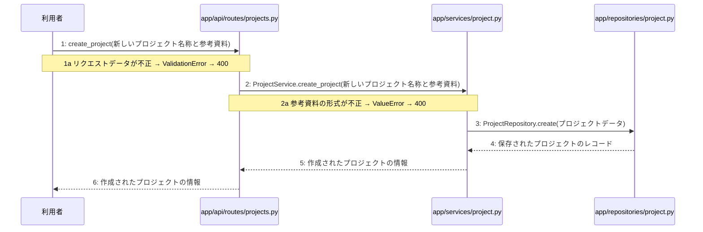

> ⚠ この単位には「未定義・要決定」が 3 件残っています(最重要 0 件)。決めてから渡すことを勧めます。

あなたは実装担当者です。以下の設計情報に従って実装してください。

## プロジェクト概要

Devex(ステージ8効果測定 詳細): 段階7のマイルストーン M-01〜M-03 を実装する。今回はそのうち、M-02(M-02: プロジェクト管理とチャット対話機能)の単位 M-02-T01 だけを扱う。

## 実装ルール

- モジュールは、段階4のモジュール一覧の依存先にだけ依存する(層を飛び越さない)。

### 07章 横断事項

| 項目 | 方針 | 関わるファイル(例) |
|---|---|---|
| 例外と HTTP | APIの処理で例外が発生した場合は、対応するHTTPステータスコードに変換して返却する。入力値の検証エラーは400 Bad Request、認証失敗やトークン無効は401 Unauthorized、アクセス権限がない場合は403 Forbidden、対象が存在しない場合は404 NotFound、一意制約違反などは409 Conflict、AI応答失敗等のサーバー内部エラーは500 Internal Server Errorを返却する。 | app/api/routes/auth.py, app/api/routes/projects.py |
| 認証 | JWTを用いた認証を実装し、アクセストークンの有効期限は30分、リフレッシュトークンは14日間としHttpOnly Cookieに設定する。ログアウト時やトークン失効時にはRedisを用いてリフレッシュトークンを無効化し、不正利用や総当たり攻撃を防ぐ。 | app/services/auth.py, app/clients/redis.py, app/repositories/user.py |
| トランザクション | データベースへの書き込みを伴う処理（ユーザー登録、ログインでのトークン保存、プロジェクト作成、チャットメッセージ保存、非同期ジョブ開始など）は、リポジトリ層との連携において1つのトランザクションとして扱い、エラー時はロールバックを行う。読み取り専用の処理では明示的なトランザクションブロックを設定しない。 | app/services/auth.py, app/services/project.py, app/repositories/user.py, app/repositories/project.py |
| ログ | セキュリティおよびプライバシーの観点から、ユーザーから入力された内容や機密情報はログに残さず、処理のエラーの有無や発生時刻、ステータスのみをログとして記録する。 | app/core/config.py, app/services/auth.py, app/services/project.py |

### 段階7 開発環境

開発環境はPython 3.13、FastAPI、Next.js(App Router)およびTamaguiを使用する。データベースにはPostgreSQL、トークン失効管理にRedisを用いる。インフラはVPS上にDocker Composeとnginxで構築し、GitHub Actionsを用いたmainブランチへのpushによる自動デプロイを行う。自動テストは単体テスト・結合テストを順次導入する方針とする。

## 今回の実装単位

M-02-T01 プロジェクト作成機能の実装(種別: 機能 / 処理: F-06)

実現する要件:

- FR-003: 自身のプロジェクトおよび関連データのみ閲覧・アクセス可能とする。
- FR-009: ユーザー、チャット履歴、生成文書をPostgreSQLに保存する。

目的: 利用者からのプロジェクト作成リクエストを受け付け、参考資料の検証とデータベースへの保存を行って作成されたプロジェクト情報を返す。

前提: M-01-T05 まで実装済み

## 作成・変更するファイル(依存順)

| ファイル | 種類 | 責務 |
|---|---|---|
| `app/repositories/project.py` | モジュール | projectsテーブルに対するPostgreSQLとのデータ入出力およびクエリの実行を行う |
| `app/services/project.py` | モジュール | プロジェクト作成のビジネスロジックの実行と制御を行う |
| `app/api/routes/projects.py` | モジュール | プロジェクト作成APIエンドポイントの定義とリクエストの受け付けを行う |
| `tests/api/test_projects.py` | テスト | プロジェクト作成機能のAPIおよび各層の結合テストを行う |

実装の要点:

- リポジトリ層、サービス層、APIルーター層の順に依存関係に沿って実装する。
- データベースへの書き込みを伴うためトランザクション制御とエラー時のロールバックを実装に含める。

## 参照する設計

### 段階5 F-06 プロジェクトを作成する

トリガー: POST /api/v1/projects

| No | 呼び出し元 → 呼び出し先 | 種別 | 関数 | 渡すデータ | 処理内容 | 結果 | DB 操作 | 分岐・例外 |
|---|---|---|---|---|---|---|---|---|
| 1 | 利用者 → app/api/routes/projects.py | 同期 | create_project | 新しいプロジェクト名称と参考資料 | プロジェクト作成APIリクエストを受け付ける | プロジェクト作成リクエスト | — | 1a へ |
| 1a | — | — | — | — | リクエストデータが不正 | — | — | ValidationError → 400 |
| 2 | app/api/routes/projects.py → app/services/project.py | 同期 | ProjectService.create_project | 新しいプロジェクト名称と参考資料 | 参考資料の形式を検証し、プロジェクト作成のビジネスロジックを実行する | 作成されたプロジェクトの情報 | — | 2a へ |
| 2a | — | — | — | — | 参考資料の形式が不正 | — | — | ValueError → 400 |
| 3 | app/services/project.py → app/repositories/project.py | 同期 | ProjectRepository.create | プロジェクトデータ | 新しいプロジェクトをPostgreSQLに保存する | 保存されたプロジェクトのレコード | projects C | — |
| 4 | app/repositories/project.py → app/services/project.py | 戻り | — | 保存されたプロジェクトのレコード | リポジトリからサービス層へ結果を返す | 作成されたプロジェクトの情報 | — | — |
| 5 | app/services/project.py → app/api/routes/projects.py | 戻り | — | 作成されたプロジェクトの情報 | サービス層からAPIルーター層へ結果を返す | 作成されたプロジェクトの情報 | — | — |
| 6 | app/api/routes/projects.py → 利用者 | 戻り | — | 作成されたプロジェクトの情報 | プロジェクト作成のレスポンスを返す | HTTP 201 Created とプロジェクト情報 | — | — |

注記: 手順 3〜4 が1つのトランザクション

シーケンス図(手順の表から導いた図。直すのは表):

- 段階6 create_project(`app/api/routes/projects.py`): 設計にありません

- 段階6 ProjectService.create_project(`app/services/project.py`): 設計にありません

- 段階6 ProjectRepository.create(`app/repositories/project.py`): 設計にありません

- 段階4 `app/api/routes/projects.py`(入口): プロジェクトおよびチャット・設計書に関するAPIエンドポイントの定義とリクエストの受け付けを行う / 依存先: app/services/project.py

- 段階4 `app/services/project.py`(ユースケース): プロジェクト管理やチャット応答・設計書生成のビジネスロジックの実行と制御を行う / 依存先: app/repositories/project.py, app/agents/chat.py, app/agents/generator.py

- 段階4 `app/repositories/project.py`(永続化): projects、chats、messages、generation_jobsテーブルに対するPostgreSQLとのデータ入出力およびクエリの実行を行う / 依存先: PostgreSQL

## テスト観点

| # | 観点 | SUT | ドライバ | スタブ |
|---|---|---|---|---|
| TC-01 | 正常なプロジェクト名称と参考資料が渡された場合にプロジェクトが作成され201が返る | app/api/routes/projects.py | 結合テスト(FastAPI TestClient) | スタブ不要 ── 実データベースまたはテスト用DBを使用 |
| TC-02 | リクエストデータが不正な場合に400 Bad Requestが返る | app/api/routes/projects.py | 結合テスト(FastAPI TestClient) | スタブ不要 ── バリデーションによる検証 |
| TC-03 | 参考資料の形式が不正な場合に400 Bad Requestが返る | app/services/project.py | 単体テスト | スタブ不要 ── サービスクラスの直接呼び出し |

- Given: 有効なプロジェクト名称と参考資料がある, When: POST /api/v1/projects にリクエストを送信する, Then: HTTP 201 Created と作成されたプロジェクト情報が返る
- Given: 不正なリクエストデータがある, When: POST /api/v1/projects にリクエストを送信する, Then: ValidationError により 400 Bad Request が返る
- Given: 不正な形式の参考資料がある, When: ProjectService.create_project を呼び出す, Then: ValueError により 400 Bad Request が返る

## 完了条件

- この単位のテストが全件成功する
- 既存のテストが壊れていない
- lint・型チェックが成功する
- (テーブルを変える単位)マイグレーションの適用が成功する
- 開発環境で起動し、確認方法の操作ができる
- 確認方法: 作成したテストを実行しすべてのテストが成功することを確認する
- 確認方法: FastClient等を用いてPOST /api/v1/projectsエンドポイントにリクエストを送り意図したレスポンスが返ることを確認する

## 未定義・要決定(決まるまで、推測で実装しないこと)

- [中程度] 段階6 create_project: 段階6の詳細処理ロジックが記載されていないため、具体的なリクエストスキーマやバリデーション仕様を定義する必要がある。
- [中程度] 段階6 ProjectService.create_project: 段階6の詳細処理ロジックが記載されていないため、参考資料の形式の検証ルールや保持するプロジェクトデータの構造を定義する必要がある。
- [中程度] 段階6 ProjectRepository.create: 段階6の詳細処理ロジックが記載されていないため、PostgreSQLへ保存する際のテーブル定義やクエリの詳細を定義する必要がある。

## 制約

- 既存の API を変更しない。
- 設計に無いことを推測で決めない。

まず現在のリポジトリを調査し、既存実装との整合性を確認してください。不整合がある場合は実装せず、問題点を報告してください。
