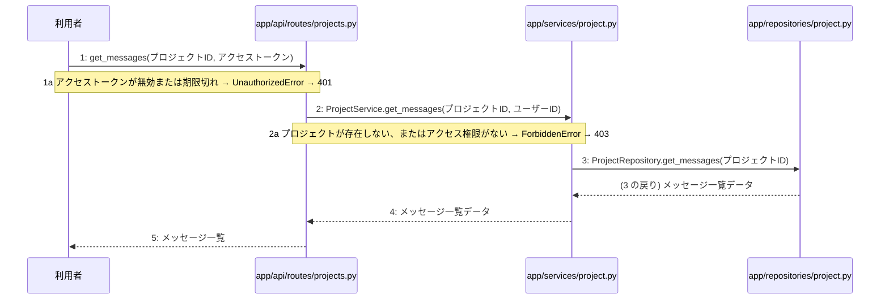

> ⚠ この単位には「未定義・要決定」が 4 件残っています(最重要 3 件)。決めてから渡すことを勧めます。

あなたは実装担当者です。以下の設計情報に従って実装してください。

## プロジェクト概要

Devex(ステージ8効果測定 詳細): 段階7のマイルストーン M-01〜M-03 を実装する。今回はそのうち、M-02(M-02: プロジェクト管理とチャット対話機能)の単位 M-02-T03 だけを扱う。

## 実装ルール

- モジュールは、段階4のモジュール一覧の依存先にだけ依存する(層を飛び越さない)。

### 07章 横断事項

| 項目 | 方針 | 関わるファイル(例) |
|---|---|---|
| 例外と HTTP | APIの処理で例外が発生した場合は、対応するHTTPステータスコードに変換して返却する。入力値の検証エラーは400 Bad Request、認証失敗やトークン無効は401 Unauthorized、アクセス権限がない場合は403 Forbidden、対象が存在しない場合は404 NotFound、一意制約違反などは409 Conflict、AI応答失敗等のサーバー内部エラーは500 Internal Server Errorを返却する。 | app/api/routes/auth.py, app/api/routes/projects.py |
| 認証 | JWTを用いた認証を実装し、アクセストークンの有効期限は30分、リフレッシュトークンは14日間としHttpOnly Cookieに設定する。ログアウト時やトークン失効時にはRedisを用いてリフレッシュトークンを無効化し、不正利用や総当たり攻撃を防ぐ。 | app/services/auth.py, app/clients/redis.py, app/repositories/user.py |
| トランザクション | データベースへの書き込みを伴う処理（ユーザー登録、ログインでのトークン保存、プロジェクト作成、チャットメッセージ保存、非同期ジョブ開始など）は、リポジトリ層との連携において1つのトランザクションとして扱い、エラー時はロールバックを行う。読み取り専用の処理では明示的なトランザクションブロックを設定しない。 | app/services/auth.py, app/services/project.py, app/repositories/user.py, app/repositories/project.py |
| ログ | セキュリティおよびプライバシーの観点から、ユーザーから入力された内容や機密情報はログに残さず、処理のエラーの有無や発生時刻、ステータスのみをログとして記録する。 | app/core/config.py, app/services/auth.py, app/services/project.py |

### 段階7 開発環境

開発環境はPython 3.13、FastAPI、Next.js(App Router)およびTamaguiを使用する。データベースにはPostgreSQL、トークン失効管理にRedisを用いる。インフラはVPS上にDocker Composeとnginxで構築し、GitHub Actionsを用いたmainブランチへのpushによる自動デプロイを行う。自動テストは単体テスト・結合テストを順次導入する方針とする。

## 今回の実装単位

M-02-T03 チャット履歴取得機能の実装(種別: 機能 / 処理: F-07)

実現する要件:

- FR-003: 自身のプロジェクトおよび関連データのみ閲覧・アクセス可能とする。
- FR-004: 対話型チャットによるヒアリング機能を提供する。
- FR-009: ユーザー、チャット履歴、生成文書をPostgreSQLに保存する。

目的: チャット履歴取得のエンドポイント、サービス、リポジトリ層を実装し、指定プロジェクトのメッセージ一覧を取得できるようにする。

前提: M-02-T02 まで実装済み

## 作成・変更するファイル(依存順)

| ファイル | 種類 | 責務 |
|---|---|---|
| `app/repositories/project.py` | モジュール | PostgreSQLから指定プロジェクトのメッセージ一覧を取得するクエリを実行する |
| `app/services/project.py` | モジュール | プロジェクトへのアクセス権限を検証し、リポジトリ層へチャット履歴の取得を指示する |
| `app/api/routes/projects.py` | モジュール | チャット履歴取得のリクエストを受け付け、サービス層を呼び出してレスポンスを返す |

実装の要点:

- 依存される順序に従い、リポジトリ層、サービス層、API層の順に実装する。
- 読み取り専用の処理であるため明示的なトランザクションブロックは設定しない。

## 参照する設計

### 段階5 F-07 チャット履歴を取得する

トリガー: GET /api/v1/projects/{id}/messages

| No | 呼び出し元 → 呼び出し先 | 種別 | 関数 | 渡すデータ | 処理内容 | 結果 | DB 操作 | 分岐・例外 |
|---|---|---|---|---|---|---|---|---|
| 1 | 利用者 → app/api/routes/projects.py | 同期 | get_messages | プロジェクトID, アクセストークン | チャット履歴取得のリクエストを受け付ける | メッセージ一覧 | — | 1a へ |
| 1a | — | — | — | — | アクセストークンが無効または期限切れ | — | — | UnauthorizedError → 401 |
| 2 | app/api/routes/projects.py → app/services/project.py | 同期 | ProjectService.get_messages | プロジェクトID, ユーザーID | プロジェクトへのアクセス権限を検証し、チャット履歴の取得を指示する | メッセージ一覧 | projects R | 2a へ |
| 2a | — | — | — | — | プロジェクトが存在しない、またはアクセス権限がない | — | — | ForbiddenError → 403 |
| 3 | app/services/project.py → app/repositories/project.py | 同期 | ProjectRepository.get_messages | プロジェクトID | PostgreSQLから指定プロジェクトのメッセージ一覧を取得する | メッセージ一覧データ | messages R | — |
| 4 | app/services/project.py → app/api/routes/projects.py | 戻り | — | メッセージ一覧データ | 取得したメッセージ一覧をAPI層へ返す | メッセージ一覧 | — | — |
| 5 | app/api/routes/projects.py → 利用者 | 戻り | — | メッセージ一覧 | チャット履歴をレスポンスとして返す | HTTP 200 OK | — | — |

注記: トランザクションは読み取り専用の参照クエリのみのため、明示的なトランザクションブロックは不要

シーケンス図(手順の表から導いた図。直すのは表):

- 段階6 get_messages(`app/api/routes/projects.py`): 設計にありません

- 段階6 ProjectService.get_messages(`app/services/project.py`): 設計にありません

- 段階6 ProjectRepository.get_messages(`app/repositories/project.py`): 設計にありません

- 段階4 `app/api/routes/projects.py`(入口): プロジェクトおよびチャット・設計書に関するAPIエンドポイントの定義とリクエストの受け付けを行う / 依存先: app/services/project.py

- 段階4 `app/services/project.py`(ユースケース): プロジェクト管理やチャット応答・設計書生成のビジネスロジックの実行と制御を行う / 依存先: app/repositories/project.py, app/agents/chat.py, app/agents/generator.py

- 段階4 `app/repositories/project.py`(永続化): projects、chats、messages、generation_jobsテーブルに対するPostgreSQLとのデータ入出力およびクエリの実行を行う / 依存先: PostgreSQL

## テスト観点

| # | 観点 | SUT | ドライバ | スタブ |
|---|---|---|---|---|
| TC-01 | 正常系: 指定プロジェクトのチャット履歴が正しく取得できること | GET /api/v1/projects/{id}/messages | 結合テスト (TestClient) | スタブ不要 ── 実際のデータベースまたはテスト用セッションを使用 |
| TC-02 | 異常系: 無効なアクセストークンの場合に401が返ること | GET /api/v1/projects/{id}/messages | 結合テスト (TestClient) | 認証モジュールを無効なトークンを返すようにモック化 |
| TC-03 | 異常系: 存在しないプロジェクトまたは権限がない場合に403が返ること | GET /api/v1/projects/{id}/messages | 結合テスト (TestClient) | サービス層の権限チェックをモック化または該当データが存在しない状態を作成 |

- Given ログイン済みのユーザーと対象プロジェクトが存在する When チャット履歴取得APIを呼び出す Then メッセージ一覧が返される
- Given 無効なアクセストークンがある When チャット履歴取得APIを呼び出す Then 401 Unauthorizedが返される
- Given ユーザーがアクセス権を持たないプロジェクトIDがある When チャット履歴取得APIを呼び出す Then 403 Forbiddenが返される

## 完了条件

- この単位のテストが全件成功する
- 既存のテストが壊れていない
- lint・型チェックが成功する
- (テーブルを変える単位)マイグレーションの適用が成功する
- 開発環境で起動し、確認方法の操作ができる
- 確認方法: 自動テストを実行し、すべてのテストケースが成功することを確認する。
- 確認方法: APIクライアントを用いてエンドポイントにリクエストを送り、期待されるステータスコードとレスポンスが得られることを確認する。

## 未定義・要決定(決まるまで、推測で実装しないこと)

- [最重要] 段階6 get_messages: 段階6の設計（ルーティング、サービス、リポジトリの詳細な入出力やクエリ内容）が記載されていないため、具体的な実装ロジックを確定できない。
- [最重要] 段階6 ProjectService.get_messages: 権限検証の詳細なルールやデータ構造が段階6に記載されていない。
- [最重要] 段階6 ProjectRepository.get_messages: messagesテーブルから取得する際のカラムやソート順等の詳細が段階6に記載されていない。
- [軽微] M-02-T03: M-02-T03 はテスト観点がありますが、作成・変更するファイルにテストのファイルがありません(手順書を作り直すか、テストのファイルを足します)。

## 制約

- 既存の API を変更しない。
- 設計に無いことを推測で決めない。

まず現在のリポジトリを調査し、既存実装との整合性を確認してください。不整合がある場合は実装せず、問題点を報告してください。
