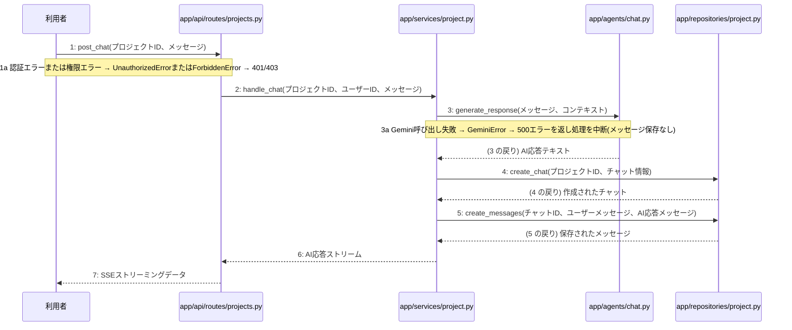

> ⚠ この単位には「未定義・要決定」が 2 件残っています(最重要 0 件)。決めてから渡すことを勧めます。

あなたは実装担当者です。以下の設計情報に従って実装してください。

## プロジェクト概要

Devex(ステージ8効果測定 詳細): 段階7のマイルストーン M-01〜M-03 を実装する。今回はそのうち、M-02(M-02: プロジェクト管理とチャット対話機能)の単位 M-02-T04 だけを扱う。

## 実装ルール

- モジュールは、段階4のモジュール一覧の依存先にだけ依存する(層を飛び越さない)。

### 07章 横断事項

| 項目 | 方針 | 関わるファイル(例) |
|---|---|---|
| 例外と HTTP | APIの処理で例外が発生した場合は、対応するHTTPステータスコードに変換して返却する。入力値の検証エラーは400 Bad Request、認証失敗やトークン無効は401 Unauthorized、アクセス権限がない場合は403 Forbidden、対象が存在しない場合は404 NotFound、一意制約違反などは409 Conflict、AI応答失敗等のサーバー内部エラーは500 Internal Server Errorを返却する。 | app/api/routes/auth.py, app/api/routes/projects.py |
| 認証 | JWTを用いた認証を実装し、アクセストークンの有効期限は30分、リフレッシュトークンは14日間としHttpOnly Cookieに設定する。ログアウト時やトークン失効時にはRedisを用いてリフレッシュトークンを無効化し、不正利用や総当たり攻撃を防ぐ。 | app/services/auth.py, app/clients/redis.py, app/repositories/user.py |
| トランザクション | データベースへの書き込みを伴う処理（ユーザー登録、ログインでのトークン保存、プロジェクト作成、チャットメッセージ保存、非同期ジョブ開始など）は、リポジトリ層との連携において1つのトランザクションとして扱い、エラー時はロールバックを行う。読み取り専用の処理では明示的なトランザクションブロックを設定しない。 | app/services/auth.py, app/services/project.py, app/repositories/user.py, app/repositories/project.py |
| ログ | セキュリティおよびプライバシーの観点から、ユーザーから入力された内容や機密情報はログに残さず、処理のエラーの有無や発生時刻、ステータスのみをログとして記録する。 | app/core/config.py, app/services/auth.py, app/services/project.py |

### 段階7 開発環境

開発環境はPython 3.13、FastAPI、Next.js(App Router)およびTamaguiを使用する。データベースにはPostgreSQL、トークン失効管理にRedisを用いる。インフラはVPS上にDocker Composeとnginxで構築し、GitHub Actionsを用いたmainブランチへのpushによる自動デプロイを行う。自動テストは単体テスト・結合テストを順次導入する方針とする。

## 今回の実装単位

M-02-T04 チャットメッセージ送信およびAI応答機能の実装(種別: 機能 / 処理: F-08)

実現する要件:

- FR-003: 自身のプロジェクトおよび関連データのみ閲覧・アクセス可能とする。
- FR-004: 対話型チャットによるヒアリング機能を提供する。
- FR-010: AIの応答失敗時は理由を表示してメッセージを保存せず再送を促し、生成失敗時は再生成を行えるようにする。
- FR-011: ログインの総当たり攻撃、登録の大量作成を防ぐ仕組みを導入し、チャットと生成にも推奨されるおすすめの回数制限を設定する。

目的: プロジェクトのチャットメッセージ送信とGeminiを用いたAI応答の生成および保存、SSEストリーミングによる返却機能を実現する。

前提: M-02-T03 まで実装済み

## 作成・変更するファイル(依存順)

| ファイル | 種類 | 責務 |
|---|---|---|
| `app/clients/gemini.py` | モジュール | Gemini Flash-Lite等の外部AIモデルとの通信を行う |
| `app/agents/chat.py` | モジュール | LangChainとLangGraphを用いたチャット応答生成を行う |
| `app/repositories/project.py` | モジュール | projects、chats、messages、generation_jobsテーブルに対するPostgreSQLとのデータ入出力およびクエリの実行を行う |
| `app/services/project.py` | モジュール | プロジェクト管理やチャット応答・設計書生成のビジネスロジックの実行と制御を行う |
| `app/api/routes/projects.py` | モジュール | プロジェクトおよびチャット・設計書に関するAPIエンドポイントの定義とリクエストの受け付けを行う |

実装の要点:

- 依存される順序に従い、外部クライアント、エージェント層、リポジトリ層、サービス層、APIルーター層の順に実装する。

## 参照する設計

### 段階5 F-08 チャットメッセージを送信する

トリガー: POST /api/v1/projects/{id}/chat

| No | 呼び出し元 → 呼び出し先 | 種別 | 関数 | 渡すデータ | 処理内容 | 結果 | DB 操作 | 分岐・例外 |
|---|---|---|---|---|---|---|---|---|
| 1 | 利用者 → app/api/routes/projects.py | 同期 | post_chat | プロジェクトID、メッセージ | チャットメッセージ送信のリクエストを受け付ける | SSEストリーミングレスポンス | — | 1a へ |
| 1a | — | — | — | — | 認証エラーまたは権限エラー | — | — | UnauthorizedErrorまたはForbiddenError → 401/403 |
| 2 | app/api/routes/projects.py → app/services/project.py | 同期 | handle_chat | プロジェクトID、ユーザーID、メッセージ | プロジェクトへのアクセス権限を検証し、チャット処理を呼び出す | AI応答ストリーム | projects R | — |
| 3 | app/services/project.py → app/agents/chat.py | 同期 | generate_response | メッセージ、コンテキスト | Gemini Flash-Liteを用いたAIの対話応答を生成する | AI応答テキスト | — | 3a へ |
| 3a | — | — | — | — | Gemini呼び出し失敗 | — | — | GeminiError → 500エラーを返し処理を中断(メッセージ保存なし) |
| 4 | app/services/project.py → app/repositories/project.py | 同期 | create_chat | プロジェクトID、チャット情報 | チャットセッションを保存する | 作成されたチャット | chats C | — |
| 5 | app/services/project.py → app/repositories/project.py | 同期 | create_messages | チャットID、ユーザーメッセージ、AI応答メッセージ | ユーザー発言とAI応答を一括保存する | 保存されたメッセージ | messages C | — |
| 6 | app/services/project.py → app/api/routes/projects.py | 戻り | — | AI応答ストリーム | SSEストリーミングによるAIの対話応答を返す | SSEストリームデータ | — | — |
| 7 | app/api/routes/projects.py → 利用者 | 戻り | — | SSEストリーミングデータ | AIの対話応答をストリーミングで返却する | 完了 | — | — |

注記: 手順3〜6が1つのトランザクション

シーケンス図(手順の表から導いた図。直すのは表):

- 段階6 post_chat(`app/api/routes/projects.py`): 設計にありません

- 段階6 handle_chat(`app/services/project.py`): 設計にありません

- 段階6 generate_response(`app/agents/chat.py`): 設計にありません

- 段階6 create_chat(`app/repositories/project.py`): 設計にありません

- 段階6 create_messages(`app/repositories/project.py`): 設計にありません

- 段階4 `app/api/routes/projects.py`(入口): プロジェクトおよびチャット・設計書に関するAPIエンドポイントの定義とリクエストの受け付けを行う / 依存先: app/services/project.py

- 段階4 `app/services/project.py`(ユースケース): プロジェクト管理やチャット応答・設計書生成のビジネスロジックの実行と制御を行う / 依存先: app/repositories/project.py, app/agents/chat.py, app/agents/generator.py

- 段階4 `app/repositories/project.py`(永続化): projects、chats、messages、generation_jobsテーブルに対するPostgreSQLとのデータ入出力およびクエリの実行を行う / 依存先: PostgreSQL

- 段階4 `app/agents/chat.py`(ユースケース): LangChainとLangGraphを用いたチャット応答生成を行う / 依存先: app/clients/gemini.py

- 段階4 `app/clients/gemini.py`(外部連携): Gemini Flash-Lite等の外部AIモデルとの通信を行う / 依存先: Gemini Flash-Lite

## テスト観点

| # | 観点 | SUT | ドライバ | スタブ |
|---|---|---|---|---|
| TC-01 | チャットメッセージ送信とAI応答のSSEストリーミング返却が正常に行われること | post_chat | 結合テスト (FastAPI TestClient) | app/clients/gemini.pyの外部API呼び出しをスタブ化し、固定のAI応答を返す |

- Given プロジェクトへのアクセス権限を持つユーザーが認証されており、チャットメッセージを入力している
- When POST /api/v1/projects/{id}/chat エンドポイントにメッセージを送信する
- Then 正常にAIの対話応答がSSEストリーミングで返却され、チャットとメッセージがデータベースに保存される

## 完了条件

- この単位のテストが全件成功する
- 既存のテストが壊れていない
- lint・型チェックが成功する
- (テーブルを変える単位)マイグレーションの適用が成功する
- 開発環境で起動し、確認方法の操作ができる
- 確認方法: pytest を実行し、チャット送信APIの結合テストが成功することを確認する。

## 未定義・要決定(決まるまで、推測で実装しないこと)

- [軽微] F-08: M-02-T04 のテスト観点1のスタブ(app/clients/gemini.py)は、F-08 の手順で SUT(app/api/routes/projects.py)から呼ばれていません(手順に無い依存です。手順に足すか、観点のスタブを直します)。
- [軽微] M-02-T04: M-02-T04 はテスト観点がありますが、作成・変更するファイルにテストのファイルがありません(手順書を作り直すか、テストのファイルを足します)。

## 制約

- 既存の API を変更しない。
- 設計に無いことを推測で決めない。

まず現在のリポジトリを調査し、既存実装との整合性を確認してください。不整合がある場合は実装せず、問題点を報告してください。
