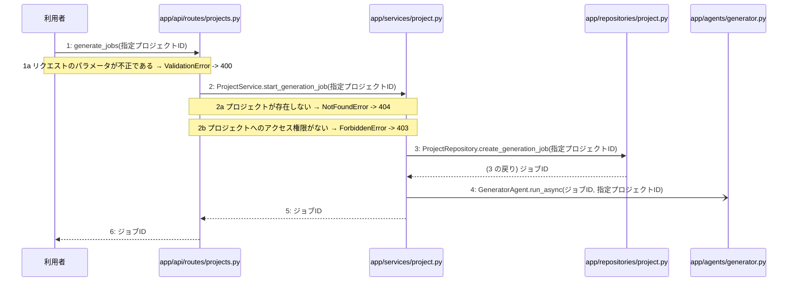

> ⚠ この単位には「未定義・要決定」が 4 件残っています(最重要 4 件)。決めてから渡すことを勧めます。

あなたは実装担当者です。以下の設計情報に従って実装してください。

## プロジェクト概要

Devex(ステージ8効果測定 詳細): 段階7のマイルストーン M-01〜M-03 を実装する。今回はそのうち、M-03(M-03: 設計書一括生成と自己診断機能)の単位 M-03-T01 だけを扱う。

## 実装ルール

- モジュールは、段階4のモジュール一覧の依存先にだけ依存する(層を飛び越さない)。

### 07章 横断事項

| 項目 | 方針 | 関わるファイル(例) |
|---|---|---|
| 例外と HTTP | APIの処理で例外が発生した場合は、対応するHTTPステータスコードに変換して返却する。入力値の検証エラーは400 Bad Request、認証失敗やトークン無効は401 Unauthorized、アクセス権限がない場合は403 Forbidden、対象が存在しない場合は404 NotFound、一意制約違反などは409 Conflict、AI応答失敗等のサーバー内部エラーは500 Internal Server Errorを返却する。 | app/api/routes/auth.py, app/api/routes/projects.py |
| 認証 | JWTを用いた認証を実装し、アクセストークンの有効期限は30分、リフレッシュトークンは14日間としHttpOnly Cookieに設定する。ログアウト時やトークン失効時にはRedisを用いてリフレッシュトークンを無効化し、不正利用や総当たり攻撃を防ぐ。 | app/services/auth.py, app/clients/redis.py, app/repositories/user.py |
| トランザクション | データベースへの書き込みを伴う処理（ユーザー登録、ログインでのトークン保存、プロジェクト作成、チャットメッセージ保存、非同期ジョブ開始など）は、リポジトリ層との連携において1つのトランザクションとして扱い、エラー時はロールバックを行う。読み取り専用の処理では明示的なトランザクションブロックを設定しない。 | app/services/auth.py, app/services/project.py, app/repositories/user.py, app/repositories/project.py |
| ログ | セキュリティおよびプライバシーの観点から、ユーザーから入力された内容や機密情報はログに残さず、処理のエラーの有無や発生時刻、ステータスのみをログとして記録する。 | app/core/config.py, app/services/auth.py, app/services/project.py |

### 段階7 開発環境

開発環境はPython 3.13、FastAPI、Next.js(App Router)およびTamaguiを使用する。データベースにはPostgreSQL、トークン失効管理にRedisを用いる。インフラはVPS上にDocker Composeとnginxで構築し、GitHub Actionsを用いたmainブランチへのpushによる自動デプロイを行う。自動テストは単体テスト・結合テストを順次導入する方針とする。

## 今回の実装単位

M-03-T01 設計書一括生成およびAI自己診断の非同期ジョブ開始機能の実装(種別: 機能 / 処理: F-09)

実現する要件:

- FR-003: 自身のプロジェクトおよび関連データのみ閲覧・アクセス可能とする。
- FR-005: ヒアリング内容を基に、要件定義・外部設計・内部設計・実装計画の4種の Markdown 設計書を一括自動生成する。
- FR-006: 生成された各文書の不足点をAIが最重要・中程度・軽微の3段階で自己診断して提示する。
- FR-010: AIの応答失敗時は理由を表示してメッセージを保存せず再送を促し、生成失敗時は再生成を行えるようにする。
- FR-011: ログインの総当たり攻撃、登録の大量作成を防ぐ仕組みを導入し、チャットと生成にも推奨されるおすすめの回数制限を設定する。

目的: 指定されたプロジェクトに対する設計書一括生成およびAI自己診断の非同期ジョブ開始機能を実装し、ジョブIDを発行して非同期にタスクを起動できるようにする。

前提: M-02-T04 まで実装済み

## 作成・変更するファイル(依存順)

| ファイル | 種類 | 責務 |
|---|---|---|
| `app/repositories/project.py` | モジュール | generation_jobsテーブルに新規ジョブレコードを作成する |
| `app/agents/generator.py` | モジュール | 4種の設計書一括生成と自己診断の非同期ジョブを起動する |
| `app/services/project.py` | モジュール | プロジェクトへのアクセス権限を検証し非同期ジョブの開始を制御する |
| `app/api/routes/projects.py` | モジュール | 設計書一括生成およびAI自己診断の非同期ジョブ開始リクエストを受け付けジョブIDを返す |
| `tests/api/test_projects.py` | テスト | 非同期ジョブ開始APIの正常系および異常系のテストを行う |

実装の要点:

- 依存関係の順序に従い、リポジトリ層、エージェント層、サービス層、APIルーター層の順に実装する。
- 手順 2 から 4 までを1つのトランザクションとして扱う。

## 参照する設計

### 段階5 F-09 設計書一括生成およびAI自己診断の非同期ジョブを開始する

トリガー: POST /api/v1/projects/{id}/generate

| No | 呼び出し元 → 呼び出し先 | 種別 | 関数 | 渡すデータ | 処理内容 | 結果 | DB 操作 | 分岐・例外 |
|---|---|---|---|---|---|---|---|---|
| 1 | 利用者 → app/api/routes/projects.py | 同期 | generate_jobs | 指定プロジェクトID | 設計書一括生成およびAI自己診断の非同期ジョブ開始リクエストを受け付ける | ジョブID | — | 1a へ |
| 1a | — | — | — | — | リクエストのパラメータが不正である | — | — | ValidationError -> 400 |
| 2 | app/api/routes/projects.py → app/services/project.py | 同期 | ProjectService.start_generation_job | 指定プロジェクトID | プロジェクトへのアクセス権限を検証し非同期ジョブの開始を依頼する | ジョブID | projects R | 2a へ、2b へ |
| 2a | — | — | — | — | プロジェクトが存在しない | — | — | NotFoundError -> 404 |
| 2b | — | — | — | — | プロジェクトへのアクセス権限がない | — | — | ForbiddenError -> 403 |
| 3 | app/services/project.py → app/repositories/project.py | 同期 | ProjectRepository.create_generation_job | 指定プロジェクトID | generation_jobsテーブルに新規ジョブレコードを作成する | ジョブID | generation_jobs C | — |
| 4 | app/services/project.py → app/agents/generator.py | 非同期 | GeneratorAgent.run_async | ジョブID, 指定プロジェクトID | 4種の設計書一括生成と自己診断の非同期ジョブを起動する | — | — | — |
| 5 | app/services/project.py → app/api/routes/projects.py | 戻り | — | ジョブID | ジョブIDを呼び出し元へ返す | ジョブID | — | — |
| 6 | app/api/routes/projects.py → 利用者 | 戻り | — | ジョブID | ジョブIDを含むレスポンスを返却する | 202 Accepted | — | — |

注記: 手順 2 から 4 が1つのトランザクション

シーケンス図(手順の表から導いた図。直すのは表):

- 段階6 generate_jobs(`app/api/routes/projects.py`): 設計にありません

- 段階6 ProjectService.start_generation_job(`app/services/project.py`): 設計にありません

- 段階6 ProjectRepository.create_generation_job(`app/repositories/project.py`): 設計にありません

- 段階6 GeneratorAgent.run_async(`app/agents/generator.py`): 設計にありません

- 段階4 `app/api/routes/projects.py`(入口): プロジェクトおよびチャット・設計書に関するAPIエンドポイントの定義とリクエストの受け付けを行う / 依存先: app/services/project.py

- 段階4 `app/services/project.py`(ユースケース): プロジェクト管理やチャット応答・設計書生成のビジネスロジックの実行と制御を行う / 依存先: app/repositories/project.py, app/agents/chat.py, app/agents/generator.py

- 段階4 `app/repositories/project.py`(永続化): projects、chats、messages、generation_jobsテーブルに対するPostgreSQLとのデータ入出力およびクエリの実行を行う / 依存先: PostgreSQL

- 段階4 `app/agents/generator.py`(ユースケース): LangChainとLangGraphを用いた文書生成および自己診断を行う / 依存先: app/clients/gemini.py

## テスト観点

| # | 観点 | SUT | ドライバ | スタブ |
|---|---|---|---|---|
| TC-01 | 正常系: 指定プロジェクトの非同期ジョブが正常に開始されジョブIDが返却されること | generate_jobs | 結合テスト(FastAPI TestClient) | スタブ不要 ── 実際のデータベースおよびエージェント層を利用する |
| TC-02 | 異常系: 存在しないプロジェクトIDを指定した場合に404エラーが返却されること | generate_jobs | 結合テスト(FastAPI TestClient) | スタブ不要 |
| TC-03 | 異常系: アクセス権限のないプロジェクトIDを指定した場合に403エラーが返却されること | generate_jobs | 結合テスト(FastAPI TestClient) | スタブ不要 |

- Given 認証済みユーザーがアクセス可能なプロジェクトが存在する
- When POST /api/v1/projects/{id}/generateを呼び出す
- Then 202 AcceptedとともにジョブIDが返却される

## 完了条件

- この単位のテストが全件成功する
- 既存のテストが壊れていない
- lint・型チェックが成功する
- (テーブルを変える単位)マイグレーションの適用が成功する
- 開発環境で起動し、確認方法の操作ができる
- 確認方法: pytestを実行し、非同期ジョブ開始に関するテストがすべて成功することを確認する。

## 未定義・要決定(決まるまで、推測で実装しないこと)

- [最重要] 段階6 generate_jobs(app/api/routes/projects.py): 段階6のロジック詳細が設計に記載されていないため、具体的なパラメータのバリデーション仕様やレスポンスのスキーマ定義を決定する必要がある。
- [最重要] 段階6 ProjectService.start_generation_job(app/services/project.py): 段階6のロジック詳細が設計に記載されていないため、アクセス権限の検証ロジックやトランザクションの境界処理の詳細を決定する必要がある。
- [最重要] 段階6 ProjectRepository.create_generation_job(app/repositories/project.py): 段階6のロジック詳細が設計に記載されていないため、generation_jobsテーブルへのINSERT文や発行されるジョブIDの形式・採番方法を決定する必要がある。
- [最重要] 段階6 GeneratorAgent.run_async(app/agents/generator.py): 段階6のロジック詳細が設計に記載されていないため、非同期バックグラウンドタスクの起動方法(FastAPI BackgroundTasksやCeleryなど)を決定する必要がある。

## 制約

- 既存の API を変更しない。
- 設計に無いことを推測で決めない。

まず現在のリポジトリを調査し、既存実装との整合性を確認してください。不整合がある場合は実装せず、問題点を報告してください。
