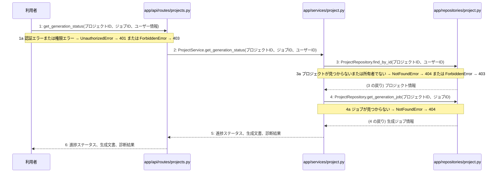

> ⚠ この単位には「未定義・要決定」が 1 件残っています(最重要 0 件)。決めてから渡すことを勧めます。

あなたは実装担当者です。以下の設計情報に従って実装してください。

## プロジェクト概要

Devex(ステージ8効果測定 詳細): 段階7のマイルストーン M-01〜M-03 を実装する。今回はそのうち、M-03(M-03: 設計書一括生成と自己診断機能)の単位 M-03-T02 だけを扱う。

## 実装ルール

- モジュールは、段階4のモジュール一覧の依存先にだけ依存する(層を飛び越さない)。

### 07章 横断事項

| 項目 | 方針 | 関わるファイル(例) |
|---|---|---|
| 例外と HTTP | APIの処理で例外が発生した場合は、対応するHTTPステータスコードに変換して返却する。入力値の検証エラーは400 Bad Request、認証失敗やトークン無効は401 Unauthorized、アクセス権限がない場合は403 Forbidden、対象が存在しない場合は404 NotFound、一意制約違反などは409 Conflict、AI応答失敗等のサーバー内部エラーは500 Internal Server Errorを返却する。 | app/api/routes/auth.py, app/api/routes/projects.py |
| 認証 | JWTを用いた認証を実装し、アクセストークンの有効期限は30分、リフレッシュトークンは14日間としHttpOnly Cookieに設定する。ログアウト時やトークン失効時にはRedisを用いてリフレッシュトークンを無効化し、不正利用や総当たり攻撃を防ぐ。 | app/services/auth.py, app/clients/redis.py, app/repositories/user.py |
| トランザクション | データベースへの書き込みを伴う処理（ユーザー登録、ログインでのトークン保存、プロジェクト作成、チャットメッセージ保存、非同期ジョブ開始など）は、リポジトリ層との連携において1つのトランザクションとして扱い、エラー時はロールバックを行う。読み取り専用の処理では明示的なトランザクションブロックを設定しない。 | app/services/auth.py, app/services/project.py, app/repositories/user.py, app/repositories/project.py |
| ログ | セキュリティおよびプライバシーの観点から、ユーザーから入力された内容や機密情報はログに残さず、処理のエラーの有無や発生時刻、ステータスのみをログとして記録する。 | app/core/config.py, app/services/auth.py, app/services/project.py |

### 段階7 開発環境

開発環境はPython 3.13、FastAPI、Next.js(App Router)およびTamaguiを使用する。データベースにはPostgreSQL、トークン失効管理にRedisを用いる。インフラはVPS上にDocker Composeとnginxで構築し、GitHub Actionsを用いたmainブランチへのpushによる自動デプロイを行う。自動テストは単体テスト・結合テストを順次導入する方針とする。

## 今回の実装単位

M-03-T02 設計書生成ジョブの進捗確認機能の実装(種別: 機能 / 処理: F-10)

実現する要件:

- FR-003: 自身のプロジェクトおよび関連データのみ閲覧・アクセス可能とする。
- FR-005: ヒアリング内容を基に、要件定義・外部設計・内部設計・実装計画の4種の Markdown 設計書を一括自動生成する。
- FR-006: 生成された各文書の不足点をAIが最重要・中程度・軽微の3段階で自己診断して提示する。

目的: 設計書生成ジョブの進捗状態をAPI経由で取得できるようにする。

前提: M-03-T01 まで実装済み

## 作成・変更するファイル(依存順)

| ファイル | 種類 | 責務 |
|---|---|---|
| `app/repositories/project.py` | モジュール | projectsテーブルおよびgeneration_jobsテーブルからのデータ取得を行う |
| `app/services/project.py` | モジュール | プロジェクトの所有権検証と生成ジョブの進捗状態取得のビジネスロジックを実行する |
| `app/api/routes/projects.py` | モジュール | 設計書生成ジョブ進捗確認APIのエンドポイントとしてリクエストを受け付ける |

実装の要点:

- リポジトリ層でデータベースからプロジェクト情報および生成ジョブ情報を取得する処理を実装したのちに、サービス層で所有権の検証と進捗状態の取得を統御し、最後にAPIルーター層でエンドポイントを追加する順序で実装する。
- 読み取り専用の処理であるため明示的なトランザクションブロックは設定しない。

## 参照する設計

### 段階5 F-10 設計書生成ジョブの進捗を確認する

トリガー: GET /api/v1/projects/{id}/generate/status

| No | 呼び出し元 → 呼び出し先 | 種別 | 関数 | 渡すデータ | 処理内容 | 結果 | DB 操作 | 分岐・例外 |
|---|---|---|---|---|---|---|---|---|
| 1 | 利用者 → app/api/routes/projects.py | 同期 | get_generation_status | プロジェクトID、ジョブID、ユーザー情報 | 設計書生成ジョブ進捗確認APIのエンドポイントとしてリクエストを受け付ける | 進捗ステータス、生成文書、診断結果 | — | 1a へ |
| 1a | — | — | — | — | 認証エラーまたは権限エラー | — | — | UnauthorizedError → 401 または ForbiddenError → 403 |
| 2 | app/api/routes/projects.py → app/services/project.py | 同期 | ProjectService.get_generation_status | プロジェクトID、ジョブID、ユーザーID | プロジェクトの所有権確認と生成ジョブの進捗状態取得を指示する | 進捗ステータス、生成文書、診断結果 | — | — |
| 3 | app/services/project.py → app/repositories/project.py | 同期 | ProjectRepository.find_by_id | プロジェクトID、ユーザーID | プロジェクトの存在と所有者権限を検証する | プロジェクト情報 | projects R | 3a へ |
| 3a | — | — | — | — | プロジェクトが見つからないまたは所有者でない | — | — | NotFoundError → 404 または ForbiddenError → 403 |
| 4 | app/services/project.py → app/repositories/project.py | 同期 | ProjectRepository.get_generation_job | プロジェクトID、ジョブID | 指定されたプロジェクトに紐づく生成ジョブの進捗情報を取得する | 生成ジョブ情報 | generation_jobs R | 4a へ |
| 4a | — | — | — | — | ジョブが見つからない | — | — | NotFoundError → 404 |
| 5 | app/services/project.py → app/api/routes/projects.py | 戻り | — | 進捗ステータス、生成文書、診断結果 | 取得した生成ジョブの進捗情報を呼び出し元に返す | 進捗ステータス、生成文書、診断結果 | — | — |
| 6 | app/api/routes/projects.py → 利用者 | 戻り | — | 進捗ステータス、生成文書、診断結果 | 生成ジョブの進捗ステータスや完了時の生成文書・診断結果を返す | レスポンス | — | — |

注記: 手順 2〜5 が1つのトランザクション

シーケンス図(手順の表から導いた図。直すのは表):

- 段階6 get_generation_status(`app/api/routes/projects.py`): 設計にありません

- 段階6 ProjectService.get_generation_status(`app/services/project.py`): 設計にありません

- 段階6 ProjectRepository.find_by_id(`app/repositories/project.py`): 設計にありません

- 段階6 ProjectRepository.get_generation_job(`app/repositories/project.py`): 設計にありません

- 段階4 `app/api/routes/projects.py`(入口): プロジェクトおよびチャット・設計書に関するAPIエンドポイントの定義とリクエストの受け付けを行う / 依存先: app/services/project.py

- 段階4 `app/services/project.py`(ユースケース): プロジェクト管理やチャット応答・設計書生成のビジネスロジックの実行と制御を行う / 依存先: app/repositories/project.py, app/agents/chat.py, app/agents/generator.py

- 段階4 `app/repositories/project.py`(永続化): projects、chats、messages、generation_jobsテーブルに対するPostgreSQLとのデータ入出力およびクエリの実行を行う / 依存先: PostgreSQL

## テスト観点

| # | 観点 | SUT | ドライバ | スタブ |
|---|---|---|---|---|
| TC-01 | 正常系: 指定したプロジェクトの有効なジョブIDで進捗状態が正常に取得できること | get_generation_status | API結合テスト | スタブ不要 ── 実際のデータベースおよびサービス層を使用する |
| TC-02 | 異常系: 存在しないプロジェクトIDまたは所有者でない場合に404または403が返却されること | get_generation_status | API結合テスト | スタブ不要 ── 実際のデータベースおよびサービス層を使用する |
| TC-03 | 異常系: 存在しないジョブIDを指定した場合に404が返却されること | get_generation_status | API結合テスト | スタブ不要 ── 実際のデータベースおよびサービス層を使用する |

- Given 認証済みユーザーが所有するプロジェクトと生成ジョブが存在する時, When GET /api/v1/projects/{id}/generate/status を呼び出すと, Then 進捗ステータス、生成文書、診断結果が返却される

## 完了条件

- この単位のテストが全件成功する
- 既存のテストが壊れていない
- lint・型チェックが成功する
- (テーブルを変える単位)マイグレーションの適用が成功する
- 開発環境で起動し、確認方法の操作ができる
- 確認方法: pytest を実行し、設計書生成ジョブの進捗確認に関するテストがすべて成功することを確認する。

## 未定義・要決定(決まるまで、推測で実装しないこと)

- [軽微] M-03-T02: M-03-T02 はテスト観点がありますが、作成・変更するファイルにテストのファイルがありません(手順書を作り直すか、テストのファイルを足します)。

## 制約

- 既存の API を変更しない。
- 設計に無いことを推測で決めない。

まず現在のリポジトリを調査し、既存実装との整合性を確認してください。不整合がある場合は実装せず、問題点を報告してください。
